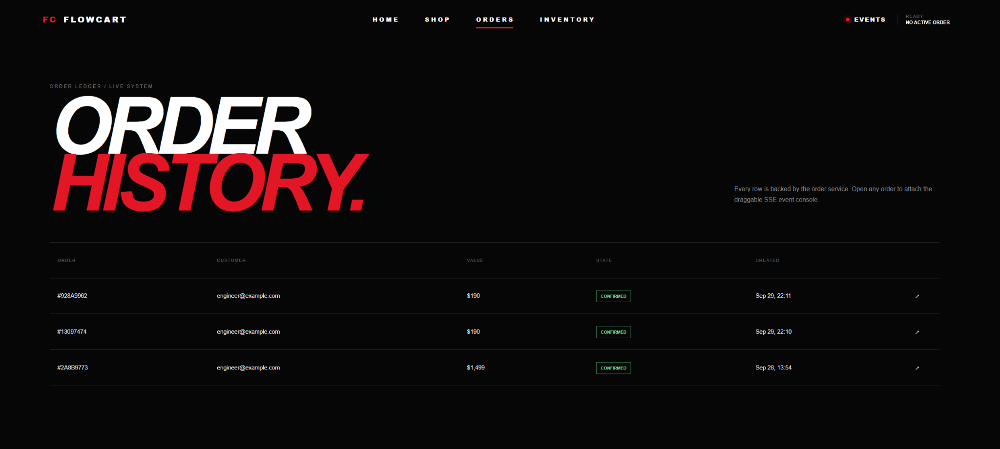
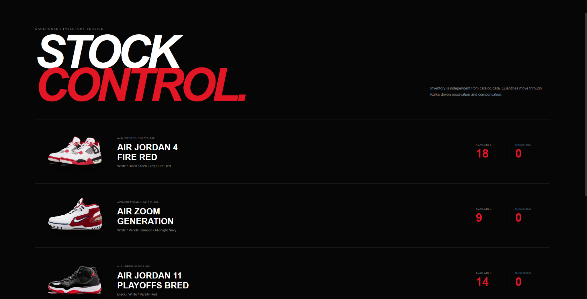
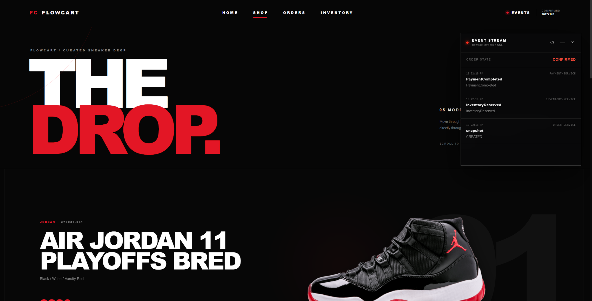
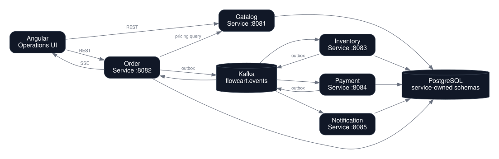

# FlowCart

**Event-driven e-commerce and order fulfillment platform built to demonstrate production-style Java backend engineering.**

FlowCart is not a CRUD storefront. It is a compact distributed system centered on the failure modes that matter in real services: database/broker consistency, duplicate delivery, eventual consistency, compensating actions, concurrency, real-time updates, performance testing, containers, CI and deployable service boundaries.

## What this project demonstrates

- Java 21 + Spring Boot 4.1
- Spring MVC REST APIs and Bean Validation
- Apache Kafka event choreography
- Transactional Outbox pattern
- Idempotent Kafka consumers
- Saga-style compensation when payment fails
- Server-Sent Events (SSE) for live order tracking
- PostgreSQL + Flyway migrations
- JPA optimistic locking for inventory
- Angular editorial storefront with draggable live event console
- k6 order throughput and concurrent SSE tests
- Testcontainers integration testing
- Docker / Docker Compose
- Kubernetes deployment templates
- GitHub Actions CI
- Spring Cloud Consul service discovery
- Spring Cloud Gateway + LoadBalancer routing
- Actuator + Prometheus-compatible metrics
- OpenAPI / Swagger UI

## Screenshots

### Storefront


### Shop runway


### Checkout


### Order history



### Inventory



### Live event stream


## Architecture



The order lifecycle is intentionally asynchronous:

```text
OrderCreated
    ↓
InventoryReserved
    ↓
PaymentCompleted ───────────────→ OrderConfirmed
    \
     \ on failure
      ↓
PaymentFailed
    ├────────→ OrderCancelled
    └────────→ InventoryReleased
```

All business events use the same Kafka topic, `flowcart.events`, keyed by `orderId`. This keeps events for one order in partition order while allowing multiple orders to be processed concurrently.

For the full reasoning, see [Architecture](docs/architecture.md), [Event Contract](docs/events.md), and the [architecture decision records](docs/decisions/).

## Services

| Service | Port | Responsibility |
|---|---:|---|
| Angular frontend | `8080` | Editorial storefront, catalog/orders/inventory views and draggable SSE event console |
| API Gateway | `8086` | Single backend entry point; routes via Consul + Spring Cloud LoadBalancer |
| Consul | `8500` | Service registry, discovery UI and health checks |
| Catalog service | `8081` | Products and authoritative pricing |
| Order service | `8082` | Order aggregate, outbox, saga state and SSE |
| Inventory service | `8083` | Reservation, optimistic locking and compensation |
| Payment service | `8084` | Deterministic payment simulator |
| Notification service | `8085` | Idempotent simulated email notifications |
| PostgreSQL | `5432` | Service-owned schemas |
| Kafka | `9092` | Event backbone |

## Run with Spring services from IntelliJ

This is the most convenient development mode if you want to debug the Java services locally.

Start only infrastructure first:

```bash
docker compose up -d postgres kafka kafka-init consul
```

Then run these Spring Boot applications from IntelliJ:

```text
CatalogServiceApplication       :8081
OrderServiceApplication         :8082
InventoryServiceApplication     :8083
PaymentServiceApplication       :8084
NotificationServiceApplication  :8085
GatewayServiceApplication       :8086
```

Finally run Angular with `npm start`.

In this hybrid mode the services register in Consul as `localhost:<port>`. Consul HTTP health
checks are disabled by default because a Consul container cannot health-check the host through its own
`localhost`. In full Docker Compose mode, `CONSUL_REGISTER_HEALTH_CHECK=true` is supplied and the
registered Docker service hostnames are health-checked normally.

## Run the complete system

Prerequisites: Docker with Docker Compose.

```bash
docker compose up --build
```

Then open:

- Operations UI: `http://localhost:8080`
- API Gateway: `http://localhost:8086`
- Consul UI: `http://localhost:8500`
- Catalog Swagger: `http://localhost:8081/swagger-ui.html`
- Order Swagger: `http://localhost:8082/swagger-ui.html`
- Inventory Swagger: `http://localhost:8083/swagger-ui.html`
- Payment Swagger: `http://localhost:8084/swagger-ui.html`
- Notification Swagger: `http://localhost:8085/swagger-ui.html`

The catalog and inventory are seeded automatically by Flyway. V2 migrations add six demo products in total, including FlowBook, FlowPods, FlowBoard, FlowMouse, FlowDisplay and FlowDock.

## Demo 1 — successful order

```bash
curl -sS -X POST http://localhost:8086/api/orders \
  -H 'Content-Type: application/json' \
  -d '{
    "customerEmail":"engineer@example.com",
    "items":[{"sku":"HEADSET-NC-01","quantity":1}],
    "simulatePaymentFailure":false
  }'
```

Copy the returned order ID and watch its stream:

```bash
curl -N http://localhost:8086/api/orders/<ORDER_ID>/events
```

The order will progress through inventory reservation, payment and confirmation without a synchronous call chain between fulfillment services.

## Demo 2 — compensation after payment failure

Create an order with `simulatePaymentFailure=true`:

```bash
curl -sS -X POST http://localhost:8086/api/orders \
  -H 'Content-Type: application/json' \
  -d '{
    "customerEmail":"engineer@example.com",
    "items":[{"sku":"KEYBOARD-MECH-01","quantity":2}],
    "simulatePaymentFailure":true
  }'
```

Observe inventory before and after:

```bash
curl -sS http://localhost:8086/api/inventory
```

The expected business outcome is:

```text
OrderCreated
→ InventoryReserved
→ PaymentFailed
   ├→ OrderCancelled → cancellation notification
   └→ InventoryReleased
```

`OrderCancelled` and `InventoryReleased` are produced by independent Kafka consumer groups, so their relative arrival order is not guaranteed. That is intentional: the invariant is that the order ends cancelled and the stock reservation is compensated, not that those two side effects happen in a particular wall-clock order.

This is a deliberately visible saga compensation path rather than hidden rollback logic.

## Service discovery and API Gateway

Every backend service includes Spring Cloud Consul Discovery and registers itself under its
`spring.application.name`. Consul checks `/actuator/health`, and discovery-aware callers can resolve
healthy service instances by logical service name.

The Angular client talks to the gateway on port `8086`:

```text
Angular
   |
   v
gateway-service
   |
   +-- lb://catalog-service ------> Consul ------> Catalog instance
   +-- lb://order-service --------> Consul ------> Order instance
   +-- lb://inventory-service ----> Consul ------> Inventory instance
```

Order Service also demonstrates service-to-service discovery: its load-balanced `RestClient` calls
`http://catalog-service`, and Spring Cloud LoadBalancer resolves that logical service name using Consul.

Kafka is unchanged: asynchronous Saga/outbox traffic still goes through `flowcart.events`; Consul is used
for HTTP discovery, not for Kafka messaging.

## Why the outbox exists

This is unsafe:

```text
1. INSERT order
2. COMMIT
3. publish OrderCreated to Kafka
```

If the process crashes between steps 2 and 3, the order exists but fulfillment never starts.

FlowCart instead commits the order and serialized `OrderCreated` row together:

```text
DB transaction
├── orders
└── outbox_events
       ↓
Outbox publisher
       ↓
Kafka
```

The publisher only writes `published_at` after Kafka acknowledges the send. A crash can therefore cause a duplicate publication, so consumers also persist processed event IDs. The two patterns are intentionally implemented together.

See [ADR-001](docs/decisions/ADR-001-transactional-outbox.md).

## REST examples

### Catalog

```http
GET /api/products
GET /api/products/{sku}
```

### Orders

```http
POST /api/orders
GET  /api/orders
GET  /api/orders/{id}
GET  /api/orders/{id}/events     # text/event-stream
```

### Inventory

```http
GET  /api/inventory
POST /api/inventory/{sku}/restock?quantity=25
```

### Payments

```http
GET /api/payments/order/{orderId}
```

### Notifications

```http
GET /api/notifications
```

## Testing

Run backend tests:

```bash
mvn test
```

The test suite includes unit tests around pricing, reservation and payment failure as well as a PostgreSQL Testcontainers integration test that verifies Flyway + JPA against a real database engine.

The integration test requires a Docker-compatible runtime.

## Performance testing with k6

Two scenarios are included under `performance-tests/k6`.

### Order throughput

```bash
k6 run performance-tests/k6/order-throughput.js
```

Tune arrival rate and duration:

```bash
RATE=25 DURATION=2m k6 run performance-tests/k6/order-throughput.js
```

The script measures REST latency plus end-to-end time until an order reaches `CONFIRMED` or `CANCELLED`.

### Concurrent SSE clients

```bash
VUS=500 DURATION=2m k6 run performance-tests/k6/sse-connections.js
```

The script imports `k6/x/sse`, opens long-lived order streams and records connection failures plus time to first event. Current k6 releases can automatically resolve supported extensions.

Suggested portfolio benchmark matrix:

| Concurrent SSE clients | Duration | Record |
|---:|---:|---|
| 100 | 2 min | baseline |
| 500 | 5 min | p95 first-event latency |
| 1,000 | 10 min | errors, CPU, heap |
| 2,500 | 10 min | degradation point |
| 5,000 | 10 min | saturation behavior |

Do not invent results in the README. Run the tests on your machine/cloud environment and replace the placeholders in [`docs/performance-results.md`](docs/performance-results.md) with real measurements and hardware details.

## Observability

Each Spring service exposes Actuator endpoints. For example:

```text
http://localhost:8082/actuator/health
http://localhost:8082/actuator/prometheus
```

Important metrics to graph when benchmarking:

- HTTP request p95/p99 latency
- active JVM threads
- heap usage / GC pauses
- Kafka consumer lag
- order completion latency
- SSE active connections
- SSE connection error rate

## Local development without Dockerized application containers

Start only infrastructure:

```bash
docker compose up postgres kafka kafka-init
```

Then run individual services from the repository root:

```bash
mvn -pl catalog-service -am spring-boot:run
mvn -pl order-service -am spring-boot:run
mvn -pl inventory-service -am spring-boot:run
mvn -pl payment-service -am spring-boot:run
mvn -pl notification-service -am spring-boot:run
```

Frontend:

```bash
cd frontend
npm install
npm start
```

The development UI is available at `http://localhost:4200`.

The frontend has four product-facing views (`HOME`, `SHOP`, `ORDERS`, `INVENTORY`). The `EVENTS` control opens a movable console that displays the live SSE trace for the active order without turning the product UI into an engineering dashboard. Inventory is read directly from port `8083`, so inventory/payment/notification services include development CORS configuration for `localhost:4200` and the Docker UI on `localhost:8080`.

## Repository layout

```text
flowcart/
├── common-events/
├── catalog-service/
├── order-service/
├── inventory-service/
├── payment-service/
├── notification-service/
├── frontend/
├── performance-tests/k6/
├── infrastructure/
│   ├── postgres/
│   └── kubernetes/
├── docs/
│   └── decisions/
├── .github/workflows/
├── docker-compose.yml
└── pom.xml
```

## Engineering decisions worth discussing in an interview

**Why Kafka instead of HTTP for fulfillment?** The workflow does not need every service online in the same request path, and the event log gives each service its own consumption/retry boundary.

**Why not claim exactly-once delivery?** The database and broker do not share a transaction here. The system embraces at-least-once delivery and makes handlers idempotent.

**Why use synchronous HTTP at all?** Product pricing is a request-time query. Using Kafka for every read would add complexity without improving the business flow. The project intentionally demonstrates choosing communication style by use case.

**How is overselling reduced?** Inventory updates occur inside database transactions and the entity has an optimistic-lock version. Under higher contention, reservation can be retried or moved to a conditional SQL update.

**Why SSE and not WebSocket?** Order tracking is server-to-client only. SSE provides reconnection semantics over normal HTTP with less protocol complexity.

**What would change in production?** Add authentication/authorization, schema registry and event versioning, dead-letter/retry policies, distributed tracing, managed Kafka/PostgreSQL, secret management, stronger inventory concurrency tests and CDC-based outbox publication.

## Roadmap

The first version intentionally focuses on the strongest backend concerns. Natural next increments are:

- Spring Security OAuth2/JWT and role-based admin endpoints
- API gateway / edge authentication
- Debezium CDC outbox publisher
- OpenTelemetry traces across HTTP and Kafka
- Prometheus + Grafana dashboard provisioning
- contract tests for event compatibility
- chaos tests for broker/database outages
- GitHub Container Registry release workflow

## License

MIT.
