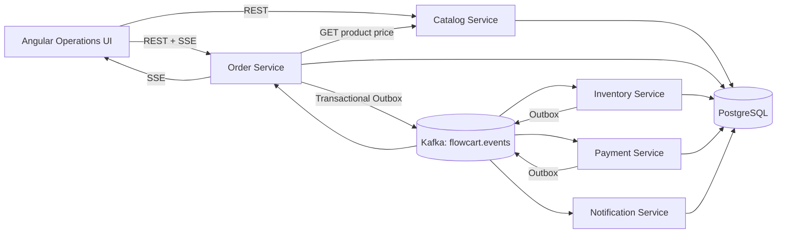
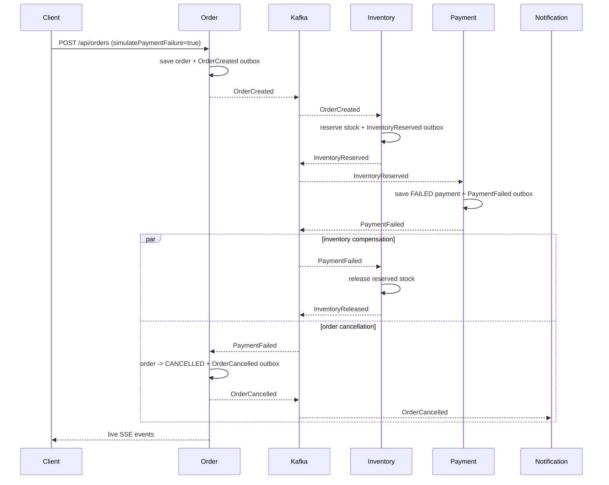

# Architecture

FlowCart is deliberately split into small services that demonstrate two communication styles:

- **Synchronous read dependency:** `order-service` asks `catalog-service` for authoritative product pricing before accepting an order.
- **Asynchronous state changes:** order fulfillment is choreographed through Kafka events. No service reaches into another service's database.

## Service boundaries

| Service | Responsibility | Port | Data ownership |
|---|---|---:|---|
| catalog-service | Product query/pricing | 8081 | `catalog` schema |
| order-service | Order aggregate, saga state, SSE projection | 8082 | `orders` schema |
| inventory-service | Stock reservation and compensation | 8083 | `inventory` schema |
| payment-service | Deterministic payment simulator | 8084 | `payment` schema |
| notification-service | Idempotent simulated email delivery | 8085 | `notification` schema |

## Reliability model

The design assumes Kafka may redeliver. Every state-changing consumer stores the source `eventId` in a table with a primary-key/unique constraint before considering the event processed. This makes duplicate delivery safe.

Every service that emits state-changing events uses a **transactional outbox**. The domain update and outbox row are committed in the same PostgreSQL transaction. A scheduled publisher forwards unpublished rows to Kafka and only then marks them published. If the process dies after Kafka accepted the event but before `published_at` is stored, the event may be sent again; idempotent consumers absorb that duplicate.

## Failure path

The two branches after `PaymentFailed` are independent consumer groups. Their relative completion order is not guaranteed; correctness depends on both side effects being idempotent, not on a global ordering between services.

## Deliberate tradeoffs

This portfolio version uses one Kafka topic keyed by order ID so all events for a given order remain in partition order. In a larger system, event schemas would be versioned (often via Avro/Protobuf + schema registry), dead-letter handling would be explicit, and the outbox publisher would normally use CDC (for example Debezium) rather than a polling scheduler.
